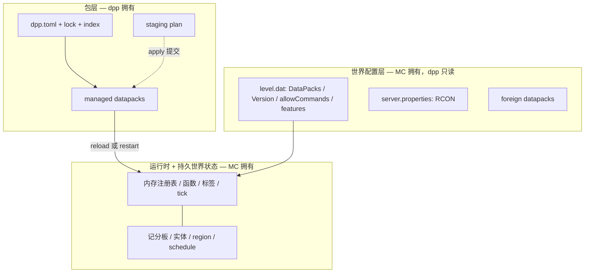

# dpp 设计

## 1. 目标与边界

dpp 是 Minecraft Java Edition 的**原版数据包管理器**：为一个世界维护可复现的数据包集合，负责下载、校验、依赖求解、安装顺序建议、原子提交和激活指引。

它不管理 mod，不管理资源包，不注入游戏，不执行包内脚本。

> 架构决策记录见 [adr/README.md](adr/README.md)。ADR 与本文冲突时，ADR 是决策来源；实现或本文需要同步更新。

核心目标：

- 同一份 `dpp.toml` + `lock.toml` 能在另一台机器上还原同一组数据包。
- 安装/更新/删除要么全部成功，要么完整回滚。
- 选择与目标世界 MC 版本、pack format 兼容的包版本。
- 明确区分“磁盘上的包状态”和“游戏运行层是否已激活”。
- 对加载顺序给出可验证的建议，而不是假装目录前缀能完全控制顺序。

## 2. 三层模型



### 2.1 包层（dpp 拥有）

dpp 可以保证的部分：

- `world/dpp.toml`：世界清单，记录直接依赖和目标 MC 版本。
- `.dpp/lock.toml`：求解后的精确版本、来源、sha512、install name。
- `.dpp/index.toml`：已安装文件清单和每文件 sha512，用于完整性检查。
- `.dpp/staging/`、`.dpp/snapshots/`、`.dpp/journal.toml`、`.dpp/trash/`。
- `world/datapacks/<install_name>/`：dpp 管理的包目录。
- 全局内容寻址缓存：`~/.cache/dpp/archives/<sha512>.zip` 与元数据缓存。

dpp 不拥有用户手动放入的数据包；这些是 `foreign datapacks`，只报告，不删除。

### 2.2 世界配置层（MC 拥有，dpp 只读）

- `level.dat`：`Data.Version`、`Data.DataPacks.Enabled/Disabled`、`Data.allowCommands`、`Data.enabled_features`。
- `server.properties`：`enable-rcon`、`rcon.*`、`level-name`。
- 外来数据包。

这一层决定 `apply` 是否可行：包是否被禁用、单人是否允许命令、RCON 是否可用、实验特性是否已开启、实际加载顺序是否与建议一致。

dpp 不写 `level.dat`。读取时注意：世界运行时 `level.dat` 可能是上次保存的状态；运行中应以 RCON 的 `/datapack list` 为补充，而不是把它当实时真相。

### 2.3 运行时 + 持久世界状态层（MC 拥有）

- 内存：注册表、函数、标签、tick 调度、已加载区块。
- 持久：记分板、实体、block entity、region、`schedule`、storage、队伍、bossbar、玩家数据。

dpp 永远不自动管理这些。它只能：

- 指引 `/reload`、重启或重进世界；
- 提示 `uninstall_hook` 的清理流程；
- 输出可能的运行时残留清单。

**为什么不是两层：** `level.dat` 是静态可读的配置，不是运行态；记分板/region 是持久状态，重启也不会消失。两者都是 MC/用户所有，但都会影响 dpp 的结果。

## 3. 状态模型

| 状态 | 来源 | 含义 |
|---|---|---|
| `desired` | `dpp.toml` + `lock.toml` | 用户期望的精确包集合 |
| `staged` | `.dpp/staging/plan.toml` | 运行中安装但尚未提交的变更 |
| `committed` | `datapacks/` + `index.toml` | 磁盘上实际已落地的包 |
| `applied` | `.dpp/applied.toml` | dpp 上次成功发送 reload / 记录手动确认的信息 |
| `observed` | RCON / `session.lock` / 日志 | 服务端是否运行、MC 版本、enabled pack 列表、reload 错误 |
| `unknown` | — | 内存中的注册表/函数内容；纯原版不可查询 |

`dpp status` 只能组合报告这些状态。不得输出“运行层已同步”这类结论；最多是 `reload sent`、`reload verified`、`unverified`、`manual required` 或 `failed`。

## 4. 文件布局

```text
world/
├── level.dat
├── dpp.toml                 # 世界清单
├── datapacks/
│   ├── 0010_terralith/      # managed，名称在首次安装时确定
│   └── 0020_incendium/
└── .dpp/
    ├── lock.toml
    ├── index.toml
    ├── applied.toml
    ├── journal.toml
    ├── txn.lock
    ├── staging/
    ├── snapshots/
    └── trash/
```

`world/dpp.toml` 与包内 `dpp.toml` 同名，靠 section 区分：

- 世界清单：`[world]` + `[dependencies]`
- 包清单：`[package]` + `[dependencies]` + `[conflicts]` + `[order]`

`dpp init` 根据 `level.dat` / `pack.mcmeta` 判断当前是 world 还是 pack；两者都存在时要求显式 `--world` / `--pack`。

## 5. 清单与锁

### 5.1 世界清单

```toml
# world/dpp.toml
schema = 1

[world]
mc_version = "26.3"        # 可省略，从 level.dat 读
pack_format = [121, 0]     # 可省略，从本地 jar 的 version.json 或内置表读

[dependencies]
terralith = ">=2.5.0"
incendium = { version = ">=5.5.0", source = "modrinth" }

[order]
default_weight = 50
# order 只作建议；不写 level.dat
```

### 5.2 数据包清单

```toml
# pack/dpp.toml
schema = 1

[package]
id = "taterlib"
version = "0.5.0"
min_format = [101, 1]
max_format = [121, 999]
mc_versions = ["26.1", "26.2", "26.3"]   # 展示/搜索用，不代替 pack format
description = "通用记分板、函数工具库数据包"

[dependencies]
sb-utils = ">=0.2.0"

[conflicts]
vanilla-tweaks = "*"

[order]
load_weight = 10
```

兼容性以 `min_format` / `max_format` 为准。`dpp build-pack` 必须交叉校验 zip 内的 `pack.mcmeta`：清单声明的范围不能比实际 zip 更宽；实际 zip 的 `pack.mcmeta` 必须在根目录。

### 5.3 lock

```toml
# .dpp/lock.toml
lock_version = 1

[metadata]
mc_version = "26.3"
pack_format = [121, 0]
generated_at = "2026-11-24T12:00:00Z"
resolver = "dpp 0.1.0"

[[package]]
id = "terralith"
source = "modrinth"
project_id = "1a2b3c4d"          # Modrinth 稳定 ID
version_id = "9x8y7z6w"          # 稳定 version ID
version_number = "2.5.3"
published_at = "2026-10-01T12:00:00Z"
sha512 = "..."
sha1 = "..."
size = 1234567
url = "https://cdn.modrinth.com/..."
file_name = "Terralith_2.5.3.zip"
manifest_hash = "sha512:..."
install_name = "0010_terralith"
load_weight = 10
```

- 不只用 `id` 当身份：lock 同时存 `source + project_id + version_id`。
- `dpp.toml` 的 `version` 与 Modrinth `version_number` 可以不同；前者供依赖范围，后者供溯源。
- 包内 `dpp.toml` 的 `id` 与源身份不一致时默认拒绝，防止冒充/依赖混淆。
- `sha512` 是主校验；`sha1` 仅兼容。Modrinth API 不提供 sha256。

### 5.4 index

`index.toml` 记录每个 managed 包的 install name、文件列表和每文件 sha512，用于：

- `dpp check` 的完整性校验（类似 `pacman -Qkk`）。
- 本地修改检测。
- 删除/回滚时确认文件归属。

## 6. 源与求解

### 6.1 Modrinth

- 搜索使用 `categories:datapack`，**不要用 `project_type:datapack`**；Modrinth 的 `project_type` 对 datapack 项目通常返回 `mod`。
- 安装必须选择 `version.loaders` 包含 `datapack` 的版本，文件必须是 `.zip`，且 zip 根目录有 `pack.mcmeta`。不要选 `.jar` 的 mod 版本。
- 版本字段以 `project_id` / `version_id` 为稳定身份；slug 会变。
- 文件 hash 使用 `files[].hashes.sha512`；同时记录 sha1 和 size。
- 依赖使用 `dependencies[].dependency_type`：`required` 求解，`optional` 提示，`incompatible` 作为冲突，`embedded` 不单独安装。
- API 要求唯一 `User-Agent`，当前限制 300 请求/分钟/IP；缓存 + 退避，不做镜像抓取。
- 依赖元数据可能为空；没有 `dpp.toml` 的包视为叶子包，`load_weight=50`，无依赖/冲突。

### 6.2 静态源

```toml
# ~/.config/dpp/sources.toml
[[source]]
name = "modrinth"
type = "modrinth"
priority = 10

[[source]]
name = "private"
type = "static"
url = "https://example.com/dpp/index.json"
priority = 20
```

静态源 `index.json` 至少包含：`id`、`version`、`url`、`sha512`、`size`、`min_format`、`max_format`、`dependencies`、`conflicts`、`load_weight`、`yanked`、`published_at`。

同一 `id` 出现在多个源时默认报歧义，要求 `source:id`；不静默取第一个源。

### 6.2.1 二期候选：Smithed

- Smithed v2 API 提供 pack/version/`supports`/datapack 下载 URL/精确版本依赖；当前响应未观察到 checksum。
- 若接入为 `type = "smithed"`，dpp 必须本地计算 sha512 并 pin，首次信任标记为 `computed/unverified`；依赖映射为精确版本。
- 不把 Smithed 响应当签名或校验和源。详见 [research-datapack.md](research-datapack.md)。

### 6.3 求解

- 目标：世界 MC 版本 → 目标 pack format。优先读本地 client/server jar 的 `version.json` 的 `pack_version.data_major/data_minor`；否则使用随 dpp 发布的内置表；允许世界清单显式覆盖。
- 候选：先按目标 pack format 过滤，再按版本范围过滤。
- 版本排序：`LooseVersion`（自然排序）→ `published_at` → `version_id`。不要直接用 SemVer 比较 `5.5.4+26.3`。
- 两阶段：
  1. 物化候选：API 查版本列表；需要元数据时下载 zip，读 `dpp.toml` + `pack.mcmeta`，缓存到 `~/.cache/dpp/meta/<sha512>.json`。
  2. 离线 pubgrub：`OfflineDependencyProvider` + `DefaultStringReporter`；失败信息必须能说明“没有版本支持 pack format X”。
- 冲突：`[conflicts]` 和 Modrinth `incompatible` 先正常求解；发现冲突对后禁用候选并有界重试，已有 lock 版本作为偏好。不要硬编码成 pubgrub 虚拟包。
- 目标 MC/pack format 变化时，lock 失效；`dpp check` 警告，`dpp update` 重新求解。

## 7. install / apply 事务

### 7.1 世界关闭

`dpp install/update/remove` 直接提交到 `datapacks/`，写 lock/index。下次启动世界时由 MC 加载。

`dpp remove` 先删除直接依赖声明，再从剩余直接依赖出发遍历已安装包的 `dpp.toml`；不可达的 lock/index 包及其 managed 目录会被删除。仍被其他包需要的目标保留；缺少 `dpp.toml` 的包按叶子处理。

- 不发送 reload。
- `dpp apply` 默认记录“下次启动生效”；`--rcon` 可发送 `/reload`。

### 7.2 世界运行中

`dpp install/update/remove` 只写 `.dpp/staging/<txid>` 和 `plan.toml`，**不动 `datapacks/`**。

`dpp apply`：

1. 若存在 staged plan，原子提交到 `datapacks/`，更新 lock/index。
2. 按 [apply.md](apply.md) 的分类选择 `/reload`、重启、重进世界或拒绝（需要新世界）。
3. 记录 `applied.toml`，或标记 `manual required`。

> 当前实现：`install/update/remove --stage` 生成 `staging/<txid>/plan.toml`；`dpp apply` 原子提交并支持 `--abort`/`--rollback`。`--rcon` 通过 `DPP_RCON_PASSWORD` 与 localhost RCON 发送 reload，成功后才写 applied marker。

这样“变更阶段不影响运行层”才是契约，而不是口号。若不做 staging，只能把该承诺降级为 best-effort。

### 7.3 journal 与回滚

- 解压只在 `.dpp/staging` 或 `.dpp/tmp` 进行，绝不直接写 `datapacks/`。
- 提交顺序：fsync staging → 旧目录 rename 到 `.dpp/trash` → 新目录 rename 到目标 → 原子写 lock/index → fsync 目录 → 清理。
- 崩溃恢复：journal 记录 `prepared/committing/committed`；下次启动回滚或补完。
- 预检磁盘空间；失败必须在任何 rename 之前返回。
- 只删除自己管理的 install name；外来包不动。

### 7.4 严格模式

- `--locked`：manifest 与 lock 不一致时失败，不改写 lock；仍允许为缺失 artifact 下载。
- `--offline`：只用缓存；缺任何 artifact 即失败。
- 不定义 `--frozen`：Cargo 的语义是 `--locked + --offline`，uv 是“用 lock 但不检查新鲜度”，容易混淆；dpp 用显式组合。见 [research-toolchain.md](research-toolchain.md)。

## 8. 加载顺序

**MVP 结论：advisory only。** 权威顺序在 `level.dat` 的 `Data.DataPacks.Enabled` 或游戏内 `/datapack enable ... before|after`，不是文件夹前缀。dpp 只生成首次安装前缀、报告偏差、打印命令；不写 `level.dat`，不自动重排。

完整决策见 [load-order.md](load-order.md)。

## 9. 命令

| 命令 | 语义 | MVP |
|---|---|---|
| `dpp new <name>` | 生成 Beet 兼容数据包骨架；不调用 Beet/Python | 是 |
| `dpp init` | 识别 world/pack，创建 `dpp.toml` 和 `.dpp/` | 是 |
| `dpp search <query>` | 搜索 Modrinth（`categories:datapack`） | 是 |
| `dpp add <pkg>` | 添加直接依赖、求解、锁定、安装 | 是 |
| `dpp remove <pkg> [--stage]` | 删除直接依赖并清理孤儿；`--stage` 只写 plan | 是 |
| `dpp install [--stage] [--locked] [--offline]` | 按 lock 同步包层；`--stage` 只写 plan；严格模式要求 lock | 是 |
| `dpp update [--stage]` | 重新求解并提交；`--stage` 只写 plan | 是 |
| `dpp apply [--dry-run] [--manual] [--rcon] [--log PATH] [--abort] [--rollback]` | 提交 staged plan；激活并验证；可 abort/rollback | 是 |
| `dpp status` | 报告五态；`--json` | 是 |
| `dpp check` | 格式、lock/index 一致性、逐文件 sha512、managed 目录缺失/额外文件、外来 datapacks、顺序偏差 | 是 |
| `dpp snapshot save/restore/list` | 包状态快照，不是世界备份 | 是 |
| `dpp order [--json] [--print-commands]` | 只读报告顺序并打印原生命令 | 是 |
| `dpp build-pack` | 校验清单/`pack.mcmeta`，确定性打包，输出 sha512/index 条目 | 是 |
| `dpp source list/add/remove` | 源管理 | 是 |
| `dpp cache clean` | 清理未被引用的归档 | 是 |

`dpp check` 只读：managed 包目录/文件缺失、sha512 漂移、额外文件、lock/index 不一致为错误；`datapacks/` 下未登记条目为警告。检查失败不自动修复。

`dpp order --apply`、`dpp order --write-level-dat`、`dpp order --rcon` 不属于 MVP；见 [load-order.md](load-order.md)。

## 10. 安全与不做

- zip-slip、绝对路径、`..`、符号链接、大小写冲突、zip bomb、保留名、过长路径：拒绝或清洗。
- 只接受根目录带 `pack.mcmeta` 的 zip；`.jar` 拒绝；混合资源包警告。
- 每次使用缓存前重新校验 sha512；不信任文件名。
- 不执行数据包内容、安装脚本、`uninstall_hook`；不自动重启服务端。
- RCON 只建议 localhost；密码从环境变量/系统钥匙串读取，不写进 lock/manifest，不打印。RCON 是明文协议。
- MVP 不写 `level.dat`；需要时先做备份、NBT 往返保真和完整测试。
- 不管理 mod、资源包、游戏注入、世界数据备份。
